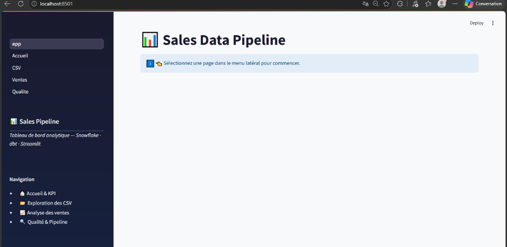
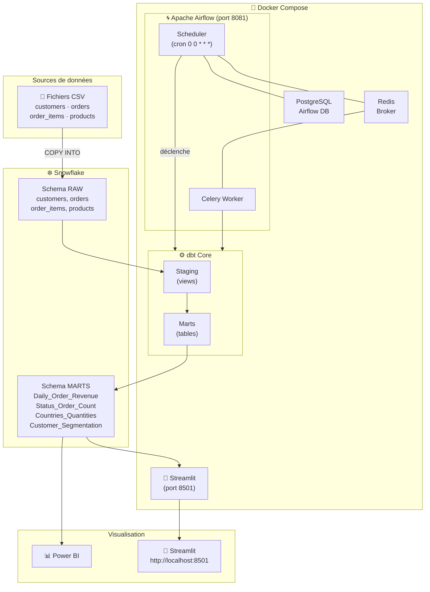

# 📊 Sales Data Pipeline — Tableau de bord Streamlit

> Application Streamlit interactive permettant d'explorer et visualiser les données du pipeline ELT en complément de Power BI.

---

## 🖥️ Aperçu de l'interface



*Page d'accueil — navigation latérale avec les 4 pages : Accueil, CSV, Ventes, Qualité.*

---

## 🏗️ Architecture complète



---

## 📁 Structure du projet Streamlit

```
streamlit_app/
├── app.py                      # Point d'entrée principal
├── pages/
│   ├── 1_Accueil.py            # KPI cards + diagramme pipeline
│   ├── 2_CSV.py                # Exploration des CSV sources
│   ├── 3_Ventes.py             # Analyse des 4 marts dbt
│   └── 4_Qualite.py            # Qualité données + statut Airflow
├── utils/
│   ├── config.py               # ⚙️ Configuration centrale (noms de tables, env vars)
│   ├── db.py                   # Connexion Snowflake + requêtes mises en cache
│   └── charts.py               # Fonctions Plotly Express réutilisables
├── .streamlit/
│   ├── config.toml             # Thème et paramètres Streamlit
│   └── secrets.toml.example    # Exemple de secrets (NE PAS committer)
├── Dockerfile                  # Image Python 3.11-slim, non-root, healthcheck
├── requirements.txt            # Dépendances avec versions épinglées
└── .env.example                # Variables d'environnement (NE PAS committer)
```

---

## ⚡ Démarrage rapide

### Prérequis
- Docker Desktop ≥ 4.x avec Docker Compose v2
- Accès Snowflake valide

### 1. Configurer les variables d'environnement

Le fichier `.env` à la racine du projet est déjà utilisé par tous les services.
Vérifiez qu'il contient bien les variables Snowflake :

```dotenv
SNOWFLAKE_ACCOUNT=VOTRE_ACCOUNT
SNOWFLAKE_USER=VOTRE_USER
SNOWFLAKE_PASSWORD=VOTRE_MOT_DE_PASSE
SNOWFLAKE_ROLE=ACCOUNTADMIN
SNOWFLAKE_DATABASE=finance_db
SNOWFLAKE_WAREHOUSE=finance_dwh
SNOWFLAKE_SCHEMA=raw
SNOWFLAKE_MARTS_SCHEMA=MARTS
```

> **Note :** La variable `SNOWFLAKE_MARTS_SCHEMA` est nouvelle — ajoutez-la si elle n'existe pas.

### 2. Lancer uniquement Streamlit

```bash
# Depuis la racine du projet
docker compose up -d streamlit
```

### 3. Lancer tout le stack

```bash
docker compose up -d
```

### 4. Accéder à l'application

| Service | URL |
|---------|-----|
| **Streamlit** | http://localhost:8501 |
| Airflow | http://localhost:8081 |
| Flower | http://localhost:5555 |

---

## 📄 Pages de l'application

| Page | Description |
|------|-------------|
| 🏠 **Accueil** | Titre, diagramme Mermaid du pipeline, 6 KPI cards (CA total, commandes, pays, clients, meilleur jour, dernière donnée) |
| 📂 **Exploration des CSV** | Aperçu, types, valeurs manquantes, describe(), doublons, graphiques auto, intégrité référentielle, export CSV |
| 📈 **Analyse des ventes** | Série temporelle CA + MM7j, statuts (donut+barres), carte choroplèthe pays, segmentation RFM |
| 🔍 **Qualité & Pipeline** | Volumétrie raw vs marts, fraîcheur, taux de nullité, statut DAG Airflow |

---

## 🔧 Configuration avancée

### Renommer une table mart

Toutes les tables sont définies dans **un seul fichier** : [`utils/config.py`](streamlit_app/utils/config.py).

```python
# utils/config.py
MART_DAILY_REVENUE      = f"{SNOWFLAKE_DATABASE}.{SNOWFLAKE_MARTS_SCHEMA}.DAILY_ORDER_REVENUE"
MART_STATUS_ORDER_COUNT = f"{SNOWFLAKE_DATABASE}.{SNOWFLAKE_MARTS_SCHEMA}.STATUS_ORDER_COUNT"
MART_COUNTRIES_QTY      = f"{SNOWFLAKE_DATABASE}.{SNOWFLAKE_MARTS_SCHEMA}.COUNTRIES_QUANTITIES"
MART_CUSTOMER_SEG       = f"{SNOWFLAKE_DATABASE}.{SNOWFLAKE_MARTS_SCHEMA}.CUSTOMER_SEGMENTATION"
```

### Activer le statut Airflow

Ajoutez dans `.env` :
```dotenv
AIRFLOW_URL=http://airflow:8080   # URL interne Docker
AIRFLOW_USER=admin
AIRFLOW_PASSWORD=admin
AIRFLOW_DAG_ID=dbt_snowflake_pipeline
```

---

## ➕ Ajouter une nouvelle page

1. Créez un fichier dans `streamlit_app/pages/` avec un préfixe numérique :
   ```
   pages/5_MaNouvellePage.py
   ```

2. Structurez la page :
   ```python
   import streamlit as st
   from utils.config import APP_TITLE

   st.set_page_config(page_title=f"Ma Page — {APP_TITLE}", page_icon="🆕", layout="wide")
   st.title("🆕 Ma Nouvelle Page")

   # Votre contenu ici
   # Données Snowflake : from utils.db import ...
   # Graphiques       : from utils.charts import ...
   ```

3. Redémarrez le conteneur :
   ```bash
   docker compose restart streamlit
   ```

Streamlit détecte automatiquement les fichiers numérotés dans `pages/` et les affiche dans l'ordre dans le menu latéral.

---

## 🐛 Dépannage

### L'app affiche "mode démo" (CSV locaux)

Le fallback CSV s'active automatiquement si Snowflake est inaccessible. Vérifiez :
```bash
# Variables d'environnement chargées ?
docker compose exec streamlit env | grep SNOWFLAKE

# Logs Streamlit
docker compose logs streamlit --tail=50
```

### Erreur de connexion Snowflake

```
RuntimeError: Variables d'environnement Snowflake manquantes.
```
→ Vérifiez que `.env` contient `SNOWFLAKE_ACCOUNT`, `SNOWFLAKE_USER`, `SNOWFLAKE_PASSWORD`.

### Le port 8501 est déjà utilisé

```bash
# Changer le port dans docker-compose.yml
ports:
  - "8502:8501"   # hôte:conteneur
```

### Reconstruire l'image après modification du code

```bash
docker compose build streamlit
docker compose up -d streamlit
```

### Vider le cache des requêtes Snowflake

Dans l'application, cliquez sur **⋮ → Clear cache** dans le menu Streamlit (coin supérieur droit).

---

## 🔒 Sécurité

- Aucun secret ne doit être commité dans Git.
- Ajoutez à votre `.gitignore` :
  ```
  .env
  streamlit_app/.streamlit/secrets.toml
  ```
- Le volume CSV est monté en **lecture seule** (`:ro`) : l'application ne peut pas modifier les données sources.
- Le conteneur tourne en tant qu'utilisateur **non-root** (`appuser`, uid=1001).

---

## 📦 Dépendances

| Package | Version | Usage |
|---------|---------|-------|
| streamlit | 1.41.1 | Framework web |
| pandas | 2.2.3 | Manipulation des données |
| plotly | 5.24.1 | Graphiques interactifs |
| snowflake-connector-python[pandas] | 3.12.4 | Connexion Snowflake |
| python-dotenv | 1.0.1 | Chargement des variables d'env |
| requests | 2.32.3 | API REST Airflow |
